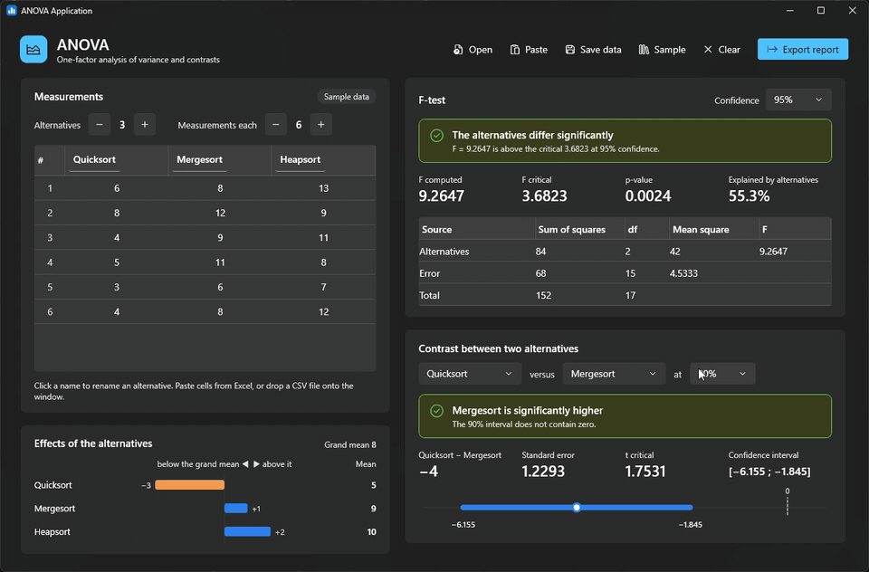
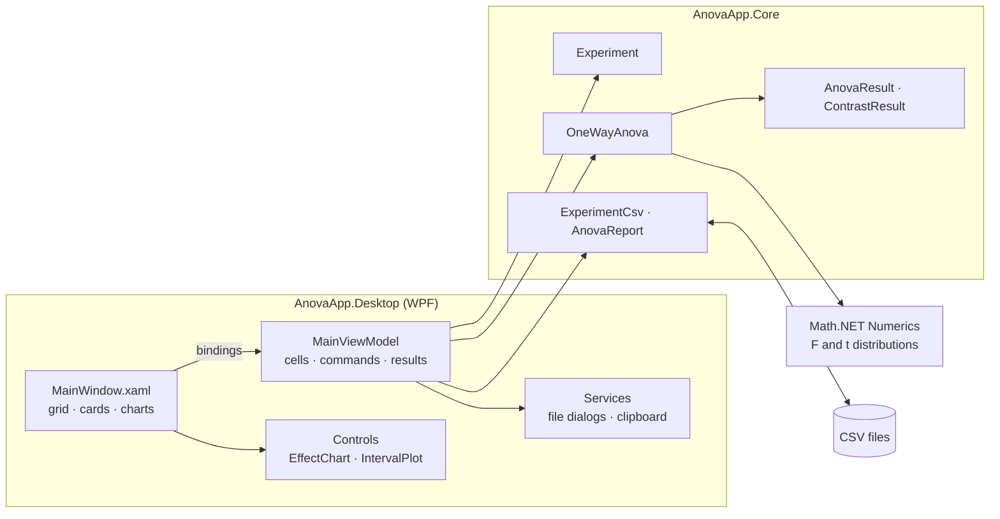
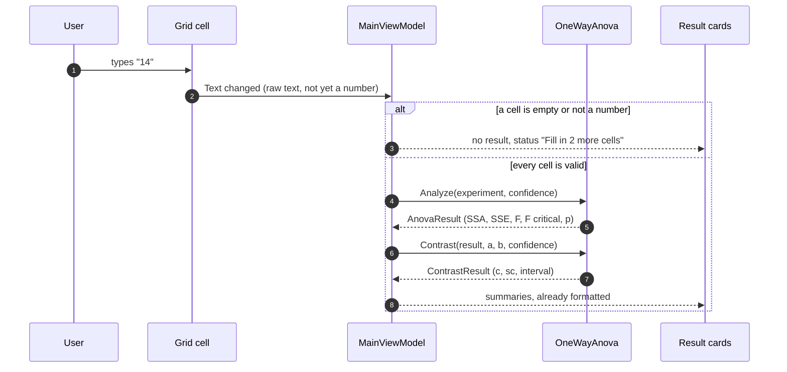

<div align="center">

# 📊 ANOVA Application

[](https://github.com/pero-grubac/ANOVA-Application/actions/workflows/ci.yml)


**One-factor analysis of variance on your desktop: type or paste the measurements, and the F-test, the effects and a contrast between any two alternatives update as you type.**



</div>

---

## 📌 Project Overview

**ANOVA Application** answers one question: *do these alternatives really differ, or is the difference just noise?* You measure each alternative (an algorithm, a configuration, a machine) the same number of times, and the app allocates the variation between the alternatives and the error, runs the F-test, and estimates a confidence interval for the difference between any two of them.

| Step | What you do | What you get |
|------|-------------|--------------|
| 1. Enter data | Type into the grid, paste from Excel, open or drop a CSV | `k` alternatives × `n` measurements, with invalid cells highlighted |
| 2. F-test | Pick a confidence level (90%, 95%, 99%, 99.9%) or type any other, such as 97.5 | Verdict, F and its critical value, p-value and the ANOVA table |
| 3. Effects | Nothing, it is always shown | How far each alternative's mean is above or below the grand mean |
| 4. Contrast | Pick two alternatives and a confidence level (its own, independent of the F-test) | `αa − αb`, its standard error and confidence interval, and whether it contains zero |

---

## ✨ Features

- 📝 **Editable grid**: 2–12 alternatives and 2–200 measurements, each column named by clicking its header
- ⚡ **Live results**: every keystroke recalculates. Empty or invalid cells are reported instead of crashing
- 📋 **Paste from a spreadsheet**: copy a block of cells (with or without a header row) and press **Paste** or `Ctrl+V`
- 📂 **CSV in and out**: open or drag in a CSV (`,` `;` or tab, decimal point or decimal comma), save the measurements, and export a full report
- 🎚️ **Any confidence level**: choose a preset or type your own (`97.5`, `97.5%` or `0.975`), separately for the F-test and the contrast
- 📈 **F-test** with the critical value from the F distribution, the p-value and the share of variation explained by the alternatives
- 📊 **Effects chart**: each alternative's deviation from the grand mean
- 🔍 **Contrasts** between any two alternatives, with the confidence interval drawn against zero
- 🌗 **Light and dark mode** that follow Windows, using the Fluent theme of WPF

### 🧮 What is computed

For `k` alternatives with `n` measurements each, where `ȳ.j` is the mean of alternative `j` and `ȳ..` the grand mean:

| Quantity | Formula | Degrees of freedom |
|----------|---------|-------------------:|
| Effect of alternative `j` | `αj = ȳ.j − ȳ..` | |
| Variation due to alternatives | `SSA = n · Σ αj²` | `k − 1` |
| Variation due to error | `SSE = Σ (yij − ȳ.j)²` | `k(n − 1)` |
| Total variation | `SST = SSA + SSE` | `kn − 1` |
| Mean squares | `sa² = SSA / (k − 1)`, `se² = SSE / k(n − 1)` | |
| F statistic | `F = sa² / se²`, compared with `F[1−α; k−1, k(n−1)]` | |
| Contrast | `c = αa − αb`, `sc = se · √(2 / n)` | |
| Interval | `c ∓ t[1−α/2; k(n−1)] · sc` | |

The alternatives differ significantly when `F` exceeds the critical value. Two alternatives differ significantly when their interval does not contain zero.

---

## 🛠️ Tech Stack

| Technology | Usage |
|------------|-------|
| .NET 10 / C# 14 | Runtime and language |
| WPF + Fluent theme | Desktop UI that follows the Windows light or dark mode |
| CommunityToolkit.Mvvm | Observable properties and commands for the view models |
| Math.NET Numerics | Inverse CDFs of the F and Student's t distributions |
| xUnit | Unit tests of the statistics and the CSV handling |
| GitHub Actions | Build, test and a self-contained `.exe` on every push |

---

## 📁 Repository Structure

```
ANOVA-Application/
├── src/
│   ├── AnovaApp.Core/              Statistics and CSV, no UI (net10.0)
│   │   ├── Experiment.cs           k alternatives × n measurements, validated
│   │   ├── OneWayAnova.cs          Analysis of variance and contrasts
│   │   ├── AnovaResult.cs          ANOVA table, F-test, p-value
│   │   ├── ContrastResult.cs       Contrast and its confidence interval
│   │   ├── ExperimentCsv.cs        Reading and writing measurements
│   │   └── AnovaReport.cs          CSV report of the results
│   └── AnovaApp.Desktop/           WPF app (net10.0-windows)
│       ├── ViewModels/             MainViewModel, grid cells, display models
│       ├── Controls/               EffectChart and IntervalPlot, drawn in code
│       ├── Services/               File dialogs and clipboard behind interfaces
│       ├── Themes/Styles.xaml      Cards, verdict banners, buttons
│       └── MainWindow.xaml
├── tests/AnovaApp.Core.Tests/      xUnit tests
├── samples/                        Example CSV
├── AnovaApp.slnx
├── Directory.Build.props           Shared build settings
├── Directory.Packages.props        Package versions in one place
└── .github/workflows/ci.yml       Build, test, publish
```

---

## 🚀 Installation

### Download

Every push to `master` builds a self-contained `AnovaApp.exe` (no .NET installation needed). Open the latest [CI run](https://github.com/pero-grubac/ANOVA-Application/actions/workflows/ci.yml) and download the **AnovaApp-win-x64** artifact.

### Build from source

**Prerequisites:** Windows 10 or 11 and the [.NET 10 SDK](https://dotnet.microsoft.com/download/dotnet/10.0).

```bash
git clone https://github.com/pero-grubac/ANOVA-Application.git
cd ANOVA-Application
dotnet run --project src/AnovaApp.Desktop
```

To build a single `.exe` yourself:

```bash
dotnet publish src/AnovaApp.Desktop -c Release -r win-x64 --self-contained -p:PublishSingleFile=true -p:EnableCompressionInSingleFile=true -o publish
```

### Tests

```bash
dotnet test
```

---

## 🧭 Usage

1. **Start the app.** It opens with sample data, so the results are visible straight away.
2. **Enter your measurements.** Set the number of alternatives and measurements with the `−` / `+` buttons and type into the grid, or:
   - copy cells in Excel and press **Paste** (`Ctrl+Shift+V`, or `Ctrl+V` on a selected cell),
   - press **Open** (`Ctrl+O`) or drag a CSV file onto the window,
   - or start the app with a file: `AnovaApp.exe samples\sorting-algorithms.csv`.
3. **Read the F-test.** The banner says whether the alternatives differ at the chosen confidence. Change the level in the top-right box: pick a preset or type any value from 50% to below 100% (`97.5`, `97.5%` and `0.975` all mean the same). While the typed value is invalid, the results stay on the last valid level.
4. **Compare two alternatives.** Choose them under *Contrast*. If the interval does not cross the dashed zero line, the difference is significant.
5. **Save.** **Save data** (`Ctrl+S`) writes the measurements, **Export report** (`Ctrl+E`) writes the ANOVA table, effects and contrast.

### CSV format

One column per alternative, one row per measurement. The header row is optional; without it the alternatives are named `A1`, `A2`, …

```csv
Quicksort,Mergesort,Heapsort,Timsort
6,8,13,7
8,12,9,9
4,9,11,6
```

A file exported from a spreadsheet in a locale with a decimal comma (`Quicksort;Mergesort` / `3,5;4,25`) is read as well.

---

## 🏗️ Architecture

The statistics live in a plain class library that knows nothing about WPF. The app talks to it through one view model, and the window only binds to it.



### What happens on every edit



---

## 🧭 Design Decisions

- **Core without UI.** `AnovaApp.Core` targets plain `net10.0`, so every formula is unit-tested without starting a window and could be reused from a CLI or a web app.
- **Exact quantiles.** Critical values come from the inverse CDFs of the F and t distributions instead of scanning the CDF in small steps, so they are exact and instant at any confidence level.
- **SSA computed directly.** `SSA = n · Σ αj²` instead of `SST − SSE`, which loses precision when the alternatives barely differ.
- **Cells keep raw text.** A cell stores what was typed, so a half-typed `3.` or `-` is not reformatted under the cursor, and a value that is not a number is highlighted instead of silently becoming zero.
- **Degenerate data handled.** With no error variation the F statistic is reported as `∞` (and `—` when all data is equal) instead of a division by zero.
- **One window, live results.** The old three-step flow (set sizes → enter data → see results in a new window) is now one screen where everything recalculates as you type.
- **Charts drawn in code.** The effects chart and the interval plot are small `FrameworkElement`s that render themselves, so they follow the theme and DPI without a charting dependency.
- **CI only when code changes.** Edits to the README, images, samples or license do not start a build.

---

## 📄 License

[MIT](LICENSE.txt) © 2025 Pero Grubač
